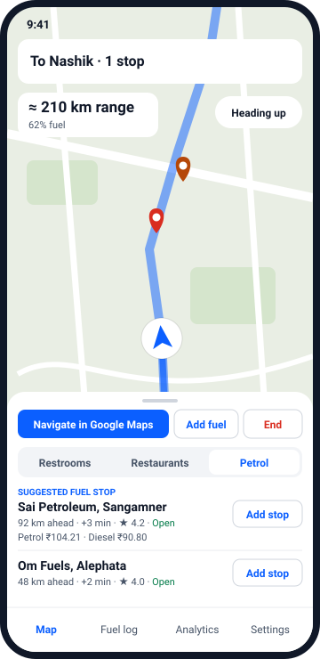
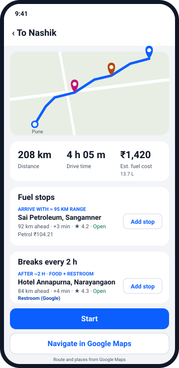
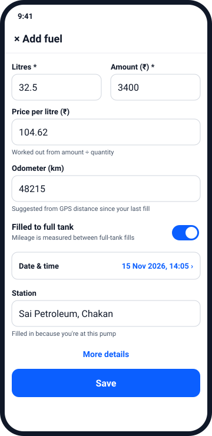
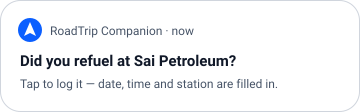
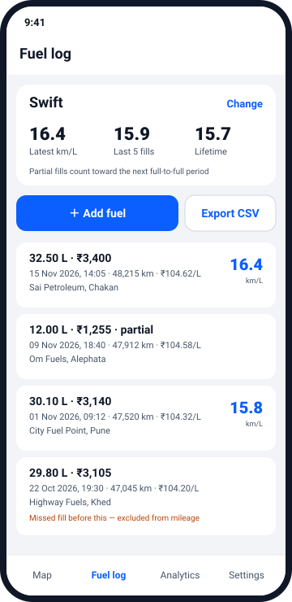
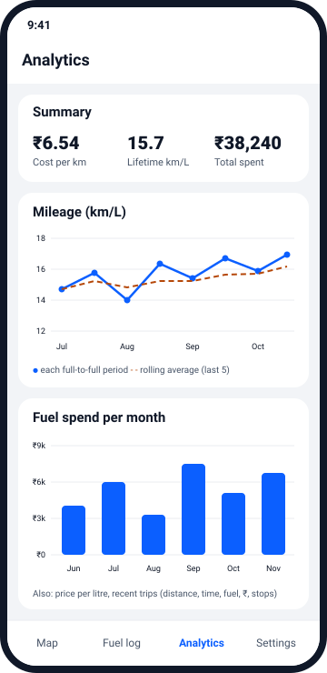
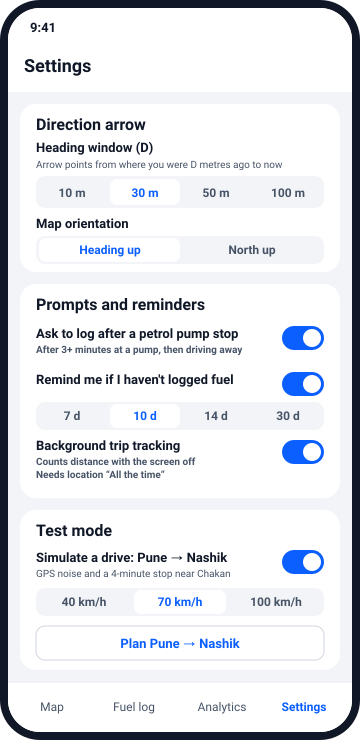
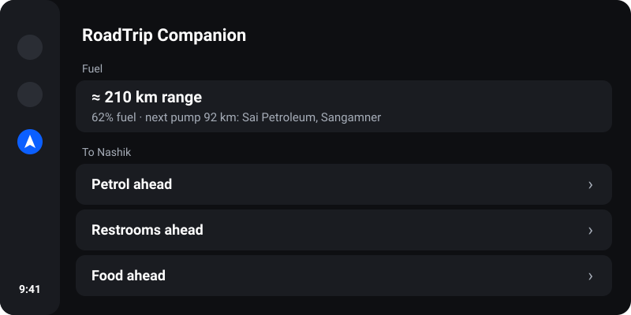
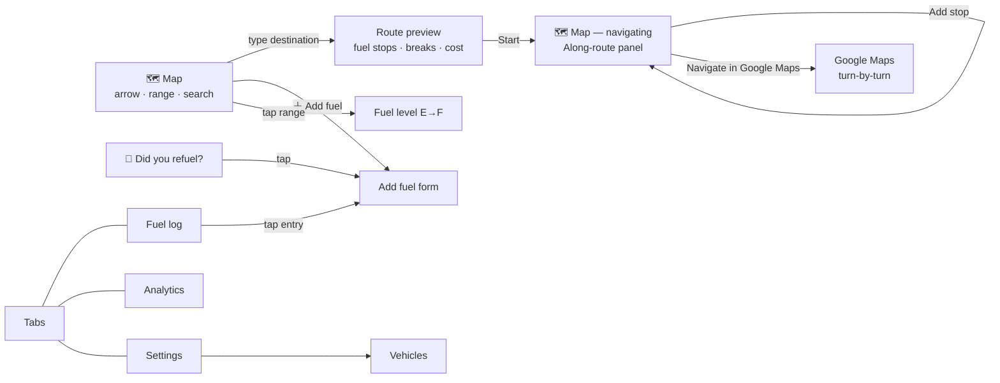
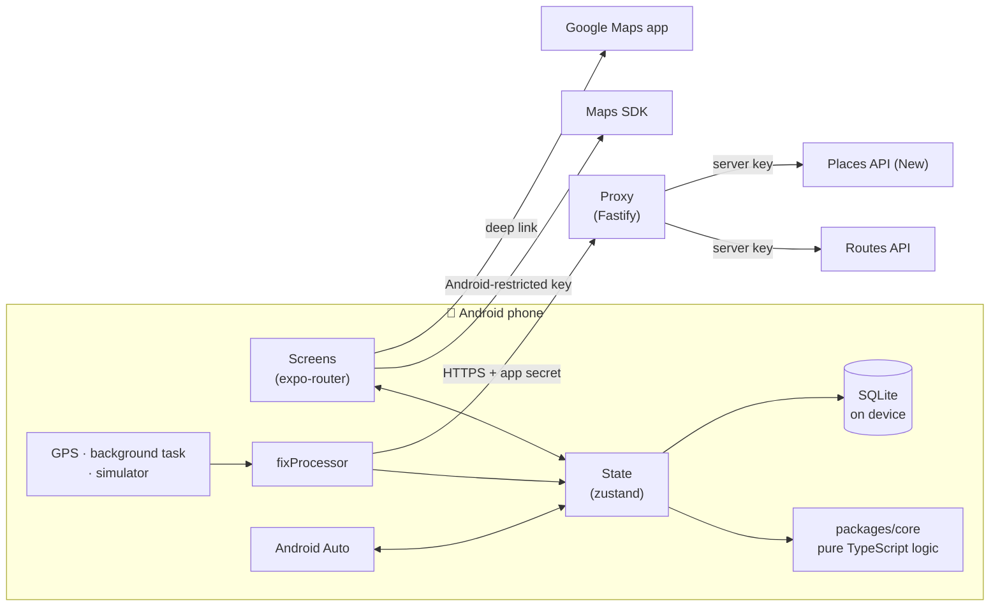

<div align="center">

# 🚗 RoadTrip Companion

**The road-trip co-pilot Google Maps doesn't have.**<br/>
A direction arrow you can trust, a fuel log that knows your real mileage, range-aware petrol pump suggestions, and restrooms and food along your route. Built for Indian highways.


[](LICENSE)


&nbsp;

&nbsp;


<sub>Screens shown are design mockups with sample data from a Pune → Nashik trip, not device screenshots.</sub>

</div>

---

## Contents

- [Why](#why)
- [Features](#features)
- [Screens](#screens)
- [Using the app](#using-the-app)
- [How it works](#how-it-works)
- [Getting started (developers)](#getting-started-developers)
- [Project structure](#project-structure)
- [Contributing](#contributing)
- [Status and roadmap](#status-and-roadmap)
- [Privacy and Google's terms](#privacy-and-googles-terms)
- [FAQ and troubleshooting](#faq-and-troubleshooting)
- [License](#license)

---

## Why

On a long drive, Google Maps gets you there. It doesn't answer the questions you actually ask on the way:

- *"Which way am I facing?"* The blue dot's direction cone uses the phone's compass, which a car's metal body and a phone mount make jumpy.
- *"Will I make it to the next town on this tank?"* Google doesn't know your car, your mileage or how much fuel you have.
- *"Where's the next decent restroom? The next veg-friendly place to eat that isn't a 20-minute detour?"*
- *"What's my real mileage, and how much am I spending per km?"*

RoadTrip Companion sits alongside Google Maps and answers these. It hands off to Google Maps for turn-by-turn navigation.

## Features

### 🧭 A direction arrow you can trust
- The arrow is based on **how you've actually moved over the last 10–100 m**, not the compass. Above 15 km/h it also blends in the GPS course.
- It **freezes when you stop**, instead of spinning from GPS jitter at a signal or toll plaza.
- A smoothly animated car marker, a **fading trail** of the last ~500 m, and **heading-up** or **north-up** camera modes.

### ⛽ Fuel log and real mileage
- **Multiple vehicles** (car or two-wheeler; petrol, diesel or CNG), one active at a time.
- **Quick log:** litres and amount are all you need.
  - The price per litre is worked out for you.
  - The odometer is suggested from GPS distance.
  - The station fills in if you're standing at a pump.
- **Full-to-full mileage:** latest, last-5 average and lifetime km/L.
  - Partial fills are handled correctly, and a "missed a fill" flag keeps your average honest.
  - If a fill is **more than 40% off your average**, the app asks you to confirm before saving.

### 📏 Fuel remaining and range
- **"≈ 210 km range"** on the map, estimated from your last fill, GPS distance driven and your own mileage.
- A clear "estimate" note until you've logged two full tanks.
- **E → F slider** to match your fuel gauge. The estimate re-syncs with the odometer at the next fill.

### 🛣️ Smarter stops along your route
- **Petrol stops planned around your range.** You always arrive above reserve. The planner prefers pumps at 60–85% of your range with a short detour that are open now and well rated. Long trips get several stops.
- **Along-route panel** with **Restrooms**, **Restaurants** and **Petrol** tabs, sorted by **km ahead along the road** (not straight-line distance). Each place shows the detour in minutes, rating, open/closed, and fuel prices when Google has them.
- **Restrooms** combine public toilets, rest stops and truck stops with pumps and restaurants that report a restroom. Each is labelled so you know which is which.
- **Restaurant filters:** open now, ★ 4+, veg-friendly, price, next 50 km, and maximum detour.
- **Break planner:** a food + restroom stop suggested every 2 h of driving (configurable).
- **Add stop** re-routes through any place. **Navigate in Google Maps** hands off turn-by-turn with your stops as waypoints.
- **No route?** When range drops below 60 km, the app shows nearby open pumps, preferring ones **ahead of you** over ones behind.

### 🔔 Prompts that do the remembering


- **"Did you refuel?"** After 3+ minutes at a petrol pump, followed by driving away, you get one tap to log it with date, time and station filled in.
- **Low-fuel alerts:** one when range drops below 2× the distance to the next suggested pump, and one at reserve.
- **Reminders** if you haven't logged fuel for 10 days, or if the fuel estimate becomes impossible (a missed fill).
- Everything can be switched off in Settings.

<br clear="right"/>

### 📊 Analytics
- km/L over time with a rolling-average line, fuel spend per month, price per litre, and cost per km.
- Per-trip summaries: distance, duration, estimated fuel and cost, stops.
- **Export the fuel log as CSV.**

### 🚘 Android Auto
- Range, next pump, and **Petrol / Restrooms / Food ahead** lists on the car's display. Tap one to navigate there in Google Maps.

### 🧪 Test mode
- Simulate a **Pune → Nashik** drive (the real Google route) with realistic GPS noise and a stop near Chakan. Try every feature from your sofa.

## Screens

<table>
  <tr>
    <td align="center" width="33%"><br/><b>Map</b><br/><sub>Heading arrow and trail, range badge, along-route panel with a suggested fuel stop</sub></td>
    <td align="center" width="33%"><br/><b>Route preview</b><br/><sub>Distance, time, estimated fuel cost, fuel stops and breaks before you set off</sub></td>
    <td align="center" width="33%"><br/><b>Add fuel</b><br/><sub>Price, odometer and station filled in for you</sub></td>
  </tr>
  <tr>
    <td align="center"><br/><b>Fuel log</b><br/><sub>Mileage per fill, partial fills, missed-fill flag, CSV export</sub></td>
    <td align="center"><br/><b>Analytics</b><br/><sub>km/L trend with rolling average, monthly spend, cost per km</sub></td>
    <td align="center"><br/><b>Settings</b><br/><sub>Heading window, prompts, background tracking, test mode</sub></td>
  </tr>
</table>

<p align="center">
  <br/>
  <b>Android Auto</b> <sub>(template screen drawn by the car)</sub>
</p>

<sub>All screens above are mockups with made-up sample data. Real screenshots are welcome; see <a href="#contributing">Contributing</a>.</sub>

### Screen flow



## Using the app

### 1. First run
1. Allow location **While using the app**. Within ~30 m of driving, a blue arrow points the way you're going.
2. Tap **"Add your vehicle to see range →"**. Enter a name, car or two-wheeler, fuel type, tank size, reserve % (15% by default) and, optionally, the claimed km/L. The claimed figure is used until you've logged two full tanks.

### 2. Logging fuel
- Tap **＋ Add fuel** on the map, or open the **Fuel log** tab.
- Enter **litres** and **amount**. Check the suggested **odometer**, and leave **Filled to full tank** on if you filled up.
- Partial fills count too. If you forgot to log a fill, open **More details → I missed logging a fill before this**, which leaves that stretch out of your average.
- If the result looks way off your usual mileage, the app asks you to check before saving.

### 3. Planning a trip
1. Type a destination in the search bar (e.g. *Nashik*) and pick a result.
2. The **route preview** shows distance, drive time, estimated fuel cost, **suggested fuel stops** (with the range you'll have when you arrive) and **breaks**.
3. Tap **Add stop** on anything you like; the route updates. Then tap **Start**.

### 4. On the road
- The **Along route** panel (Petrol / Restrooms / Restaurants) shows places ahead with km ahead, detour minutes, rating and open/closed. Tap **Add stop** to go via one.
- Tap **Navigate in Google Maps** for turn-by-turn with your stops included.
- Turn on **Settings → Background trip tracking** (needs location *"Allow all the time"*) to keep distance, range and refuel prompts working with the screen off. A notification shows whenever tracking is on.
- Range looks wrong? Tap the **range badge** and set the fuel gauge.

### 5. Try it without driving
**Settings → Test mode → Simulate a drive: Pune → Nashik**, then **Plan Pune → Nashik → Start**.
- Pick 40, 70 or 100 km/h at 1×, 5× or 20× speed.
- After the stop near Chakan (~25 km), you'll get a "Did you refuel? (test)" prompt.
- Nothing from test mode is saved.

### 6. In the car (Android Auto)
Open **RoadTrip Companion** on the car screen to see range and the next pump. During a trip, open *Petrol / Restrooms / Food ahead* and tap a place to navigate there.

## How it works



- **The pure logic lives in `packages/core`**, with no React or network code, and is covered by unit tests: heading, mileage, range, route projection, stop planning, refuel detection and analytics.
- **A small proxy holds the Google key.** The app only has an Android-restricted Maps SDK key.
- **Your data stays on the phone** in SQLite.

<details>
<summary><b>The interesting algorithms (click to expand)</b></summary>

**Heading arrow** (`packages/core/src/heading/headingEstimator.ts`)
1. Drop fixes with accuracy worse than 20 m, and jumps that would need more than ~250 km/h.
2. **Trend bearing:** the great-circle initial bearing from the most recent fix at least *D* metres behind (10/30/50/100 m, default 30) to the current fix.
3. Above 15 km/h, blend with a valid GPS course (circular weighted mean).
4. Smooth on the **sin/cos components**, so 359° → 1° turns 2° through north rather than 358° the long way.
5. **Freeze** below 1.5 m/s, or when you've moved less than min(*D*, 15 m) in the last 10 s.

**Mileage (full-to-full).** km/L = (odometer at a full fill − odometer at the previous full fill) ÷ all fuel added after the previous full fill, up to and including this one. A period containing a "missed fill" entry is skipped.

**Fuel remaining.**
- A full fill sets the tank to capacity; a partial fill adds to the previous estimate, capped at capacity.
- Between two fills, fuel used comes from the **odometer difference**, so each log re-syncs the estimate. After the last fill or gauge correction, it uses **GPS distance**: fixes worse than 25 m are ignored, as are impossible jumps and movement smaller than the accuracy radius.

**Petrol stop planning.**
- Places are projected onto the route polyline to get **km ahead along the road**.
- **Detour** = (here → pump → end) − (here → end), from Google's routing summaries. When those aren't returned, it's estimated from the distance off the route.
- A candidate scores well inside the 60–85% window and loses points for detour, being closed or having unknown hours, and a poor rating. A stop is never planned past the point where you'd drop below reserve.

**Refuel detection.** GPS alone spots a stay within 60 m for more than 3 minutes. Only then does the app make **one** Places Nearby Search to find the pump. Driving 150 m away triggers the prompt, at most once per stop.

**Cost control.**
- Every Google call uses a **field mask**, and the pricier fields are requested only by the tab that needs them.
- Routes are cached for the session.
- Along-route searches run per 100 km window and refresh only after ~30 km of driving.
- Destination search runs on submit, not per keystroke.

</details>

## Getting started (developers)

> 🤖 **Using Claude Code or another agent?** [SETUP.md](SETUP.md) is a step-by-step runbook with verification commands and full architecture diagrams.

### Prerequisites
- **Node.js ≥ 24.9** (24.3 works) and npm ≥ 11.
- **Android Studio** (JDK 17 + Android SDK + Platform-Tools), with `ANDROID_HOME` set and `platform-tools` on your `PATH`.
- An Android phone with **USB debugging** on. Expo Go is not enough: the app needs a development build for its custom Maps key, background location and Android Auto.
- A **Google Cloud** project with billing enabled.

### Google Cloud setup
1. Enable **Maps SDK for Android**, **Routes API** and **Places API (New)**.
2. Create two keys:

| Key | Goes in | Application restriction | API restriction |
|---|---|---|---|
| App key | `apps/mobile/.env` → `ANDROID_MAPS_API_KEY` | Android apps: `com.roadtripcompanion.app` + your SHA-1 | Maps SDK for Android |
| Server key | `apps/proxy/.env` → `GOOGLE_MAPS_API_KEY` | none, or your server's IP | Routes API, Places API (New) |

3. After your first build, get the debug SHA-1 and add it to the app key:
   `keytool -list -v -keystore apps/mobile/android/app/debug.keystore -alias androiddebugkey -storepass android -keypass android | grep SHA1`

### Install and check
```sh
git clone <your-repo-url> roadtrip-companion && cd roadtrip-companion
npm install
npm run check          # typecheck + ESLint + 161 unit tests; needs no keys
```

### Run the proxy
```sh
cp apps/proxy/.env.example apps/proxy/.env   # set GOOGLE_MAPS_API_KEY and PROXY_SHARED_SECRET (openssl rand -hex 32)
npm run dev -w @roadtrip/proxy               # → http://localhost:8787/health
```

| Endpoint (all need `X-App-Secret`) | Google API |
|---|---|
| `POST /v1/route` | Routes API `computeRoutes` (DRIVE / TWO_WHEELER, waypoints by place ID) |
| `POST /v1/along-route` | Places Text Search + `searchAlongRouteParameters` + `routingSummaries` |
| `POST /v1/nearby-fuel` | Places Nearby Search, `gas_station`, by distance |
| `POST /v1/destinations` | Places Text Search for the destination bar |

### Deploy the proxy
Your phone needs to reach the proxy over mobile data, so deploy it for real trips. For example, on Cloud Run (`$PROJECT` is your Google Cloud project ID):
```sh
gcloud builds submit --tag gcr.io/$PROJECT/roadtrip-proxy -f apps/proxy/Dockerfile .    # build from the repo root
gcloud run deploy roadtrip-proxy --image gcr.io/$PROJECT/roadtrip-proxy --region asia-south1 --allow-unauthenticated \
  --set-secrets GOOGLE_MAPS_API_KEY=roadtrip-maps-key:latest,PROXY_SHARED_SECRET=roadtrip-proxy-secret:latest
```

### Run the app
```sh
cp apps/mobile/.env.example apps/mobile/.env   # ANDROID_MAPS_API_KEY, EXPO_PUBLIC_PROXY_URL, EXPO_PUBLIC_PROXY_SECRET
cd apps/mobile
npx expo run:android                           # first native build + install on the connected phone
npx expo start                                 # afterwards, for JavaScript-only changes
```
For a local proxy, set `EXPO_PUBLIC_PROXY_URL` to your computer's LAN IP (e.g. `http://192.168.1.20:8787`). **Settings → Test proxy connection** checks it.

### Android Auto testing
1. In the Android Auto app settings on the phone, tap *Version* 10× to unlock developer settings, then enable **Unknown sources**.
2. Install the **Desktop Head Unit** (Android Studio → SDK Manager → SDK Tools).
3. In Android Auto's developer menu, choose *Start head unit server*. Then run `adb forward tcp:5277 tcp:5277` and `$ANDROID_HOME/extras/google/auto/desktop-head-unit`.

## Project structure

```
roadtrip-companion/
├── packages/core/            Pure TypeScript domain logic + Jest tests (no React, no network)
│   └── src/
│       ├── geo/              distance, bearing, polyline codec, path helpers
│       ├── heading/          heading estimator, angle smoothing, fix buffer
│       ├── tracking/         fix gate, jitter-free distance, breadcrumb, pipeline
│       ├── fuel/             mileage, validation, fuel-level estimate, range
│       ├── route/            route projection, along-route ranking, Google Maps deep link
│       ├── stops/            fuel stop planner, nearby ranking, alerts, filters, break planner
│       ├── refuel/           dwell detector, reminders
│       ├── analytics/        series, summaries, CSV
│       └── sim/              drive simulator + Pune → Nashik fixture
├── apps/proxy/               Fastify proxy for Routes + Places (New); Dockerfile for Cloud Run
├── apps/mobile/              Expo / React Native app
│   ├── app.config.ts         permissions, Maps key, plugins
│   ├── plugins/              config plugins (Android Auto category)
│   └── src/
│       ├── app/              screens (file-based routing)
│       ├── components/       map, fuel, route, ui
│       ├── state/            zustand stores (tracking, garage, route, settings)
│       ├── services/         location, fixProcessor, proxy client, notifications, reminders, export
│       ├── db/               SQLite schema, migrations, repositories
│       └── car/              Android Auto screens
├── docs/screens/             README mockups (SVG)
├── README.md                 you are here
└── SETUP.md                  setup runbook + architecture diagrams
```

## Contributing

Contributions are very welcome: bug reports, real-device testing, screenshots and code.

### Ground rules
1. **Keep `packages/core` pure.** No React, Expo, network or Node imports (ESLint enforces this). New logic goes there **with tests**. UI and services stay thin.
2. **Never commit secrets.** `.env` files, keystores and keys are git-ignored; keep it that way. Only `.env.example` files are committed.
3. **Respect Google Maps Platform terms.**
   - Don't store Places content beyond `place_id`.
   - Show Google data on a Google map, or with "Google Maps" attribution where there's no map.
   - Always use field masks. Check field names against the current Google docs rather than going from memory.
4. **Don't edit `apps/mobile/android/` or `ios/` by hand.** They're generated by `expo prebuild`. Use `app.config.ts` or a config plugin in `apps/mobile/plugins/`.
5. **Add app dependencies with `npx expo install <pkg>`** so versions match Expo SDK 58. React is pinned to exactly 19.3.0 at the root, because React Native requires a matching renderer.
6. **Battery and data matter.** Anything that adds GPS work or API calls needs a good reason and a throttle.

### Development workflow
```sh
npm run check                         # run before every commit: typecheck + lint + tests
npm test -w @roadtrip/core            # core tests only
npx jest --watch                      # from packages/core, while working on logic
cd apps/mobile && npx expo-doctor     # after changing app dependencies
```

### Where does my change go?

| You want to… | Put it in |
|---|---|
| Change how heading, mileage, range or stops are calculated | `packages/core/src/…` + a test in `__tests__/` |
| Call a new Google API or change a field mask | `apps/proxy/src/google/` + `routes/api.ts` + a mocked test |
| Add or change a screen | `apps/mobile/src/app/` (+ `components/`) |
| Persist new data | `apps/mobile/src/db/database.ts` (add a **new migration**, never edit old ones) + `repositories.ts` |
| React to every GPS fix | `apps/mobile/src/services/tracking/fixProcessor.ts` |
| Add a setting | `apps/mobile/src/state/settingsStore.ts` + the Settings screen |
| Change native or Android config | `apps/mobile/app.config.ts` or `apps/mobile/plugins/` |

### Pull request checklist
- [ ] `npm run check` passes.
- [ ] New or changed logic in `packages/core` has tests, including edge cases (0/360°, empty data, first entry).
- [ ] User-facing text is clear, uses km, ₹ and litres (kg for CNG), and handles offline, denied-permission and API-error states without crashing.
- [ ] No secrets, generated native folders or `node_modules` in the diff.
- [ ] For UI changes: a screenshot or screen recording from a real device or emulator.
- [ ] For new Google API usage: the field mask is listed, and you've noted the billing tier.

Commit messages: a short imperative summary line ("Add CNG price filter to petrol tab"), then a body explaining *why*.

### Good places to start
- 📸 **Real screenshots** from a device to replace the mockups in `docs/screens/`.
- ✅ **Confirm two Google behaviours** against live responses:
  - the `places.currentOpeningHours.openNow` field mask;
  - what `routingSummaries.legs[1]` measures in search-along-route (the detour maths assumes place → end of the searched polyline).
- 🧪 **App-level tests** with `jest-expo` and React Native Testing Library. The core and proxy are tested; the screens aren't yet.
- 🔁 **CI**: a GitHub Actions workflow running `npm run check` on pull requests.
- 🍎 **iOS** build and testing, then **CarPlay** (needs Apple's fueling entitlement).
- ⚡ **EV support**: charging stations via `evChargeOptions`, and range in kWh.
- 🌐 **Hindi / Marathi** translations.
- 🌙 Dark mode.

### Reporting bugs
Please include:
- your phone model and Android version;
- whether you were in test mode;
- steps to reproduce;
- `adb logcat *:E ReactNativeJS:V` output if the app crashed.

**Never paste API keys or your `.env` files into issues.**

## Status and roadmap

| Milestone | Scope | Code | Device-tested |
|---|---|---|---|
| 1 | Live map, heading arrow, trail, test mode | ✅ | ⏳ |
| 2 | Vehicles, fuel log, mileage, range | ✅ | ⏳ |
| 3 | Routing, along-route search, fuel stops, re-routing | ✅ | ⏳ |
| 4 | Refuel detection, reminders, background location | ✅ | ⏳ |
| 5 | Analytics, CSV export, docs | ✅ | ⏳ |
| 6 | Android Auto screens | ✅ | ⏳ |
| — | iOS, CarPlay | ⬜ | ⬜ |

**Early preview.** Everything is implemented and checked by typecheck, lint, 161 unit tests, an Android bundle build, `expo prebuild` and `expo-doctor`, but **not yet run on a physical device**. Expect rough edges. Device testing and screenshots are the most valuable contributions right now.

Known limitations:
- Fuel prices and restroom data from Google are often missing in India. Highway pumps without data are labelled "restroom likely", which you can turn off in Settings.
- Android Auto opens Google Maps through the phone (the car library has no navigation handoff). Android may block this while the app is in the background, so it needs testing with the Desktop Head Unit.

## Privacy and Google's terms

- **On-device only:** vehicles, fuel log, trips, distance and settings live in SQLite on your phone. There's no account and no analytics.
- **What leaves the phone:** route and place searches go to your own proxy, then to Google. They include your location and destination, which is what's needed to search along your route.
- **Google content:** Places data is kept for the session only; just `place_id` is stored. Google data is shown on Google maps, or with "Google Maps" attribution in lists.
- **Keys:** the Google server key never leaves the proxy. The app's proxy secret ships inside the app, so it only keeps strangers off your proxy.

## FAQ and troubleshooting

<details>
<summary><b>The map is blank or grey.</b></summary>

The app key, package name or SHA-1 restriction is wrong. Check that `ANDROID_MAPS_API_KEY` is restricted to `com.roadtripcompanion.app` with your build's SHA-1, and that Maps SDK for Android is enabled. Rebuild after changing `.env` (`npx expo run:android`).
</details>

<details>
<summary><b>"Google rejected the server API key" / "Proxy URL is not set".</b></summary>

- Check `apps/proxy/.env`: `GOOGLE_MAPS_API_KEY` must have Routes API and Places API (New) enabled.
- Check `apps/mobile/.env`: `EXPO_PUBLIC_PROXY_URL` must point at the proxy. Use your LAN IP, not `localhost`, from a phone.
- **Settings → Test proxy connection** checks the URL and secret.
</details>

<details>
<summary><b>Range says "estimate".</b></summary>

It firms up once you've logged two full-tank fills in a row. Until then it uses the claimed km/L you entered, or a sensible default.
</details>

<details>
<summary><b>The arrow doesn't move when I start driving.</b></summary>

It needs about *D* metres of movement (30 m by default) before it knows your direction. Below walking speed it deliberately stays frozen.
</details>

<details>
<summary><b>I don't get "Did you refuel?" prompts.</b></summary>

- Notifications must be allowed, and **Ask to log after a petrol pump stop** must be on.
- With the screen off, **Background trip tracking** must be on, with location set to "Allow all the time".
- The stop has to last 3+ minutes at a place Google lists as a petrol station.
</details>

<details>
<summary><b>Will this cost me money on Google Cloud?</b></summary>

Google Maps Platform bills per request, with a monthly free tier. A typical trip makes a handful of route calls and a few dozen place searches, and the app is built to keep that low (field masks, caching, windowed searches). Set a budget alert on your project to be safe.
</details>

## License

Licensed under the [Apache License, Version 2.0](LICENSE). See [NOTICE](NOTICE) for attribution.

You can use, modify and distribute this code, including commercially, as long as you keep the license and notices and mark the files you change. The license includes a patent grant from contributors. It does **not** grant rights to the "RoadTrip Companion" name. By submitting a pull request, you agree your contribution is licensed under Apache 2.0 (section 5 of the license).

Using the app's Google features requires your own Google Maps Platform keys, under [Google's terms](https://cloud.google.com/maps-platform/terms).

## Acknowledgements

- [Expo](https://expo.dev) and [React Native](https://reactnative.dev)
- [react-native-maps](https://github.com/react-native-maps/react-native-maps)
- [@iternio/react-native-auto-play](https://github.com/Iternio-Planning-AB/react-native-auto-play) for Android Auto
- [react-native-gifted-charts](https://github.com/Abhinandan-Kushwaha/react-native-gifted-charts)
- Google Maps Platform: Routes API, Places API (New), Maps SDK for Android
