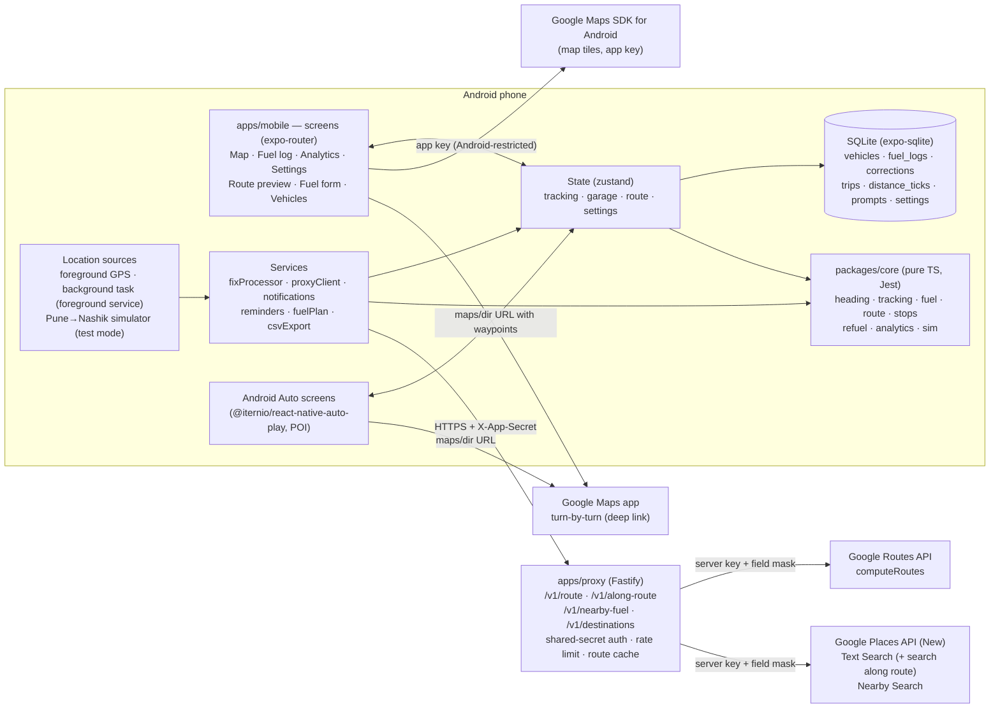
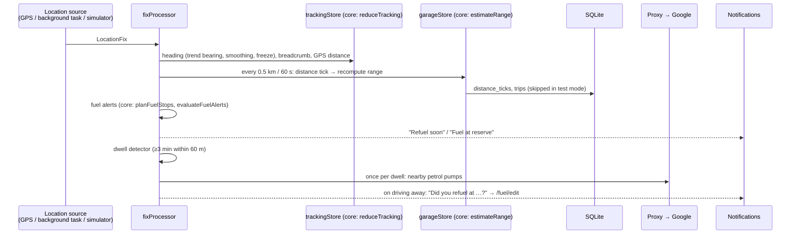

# RoadTrip Companion — architecture and setup runbook

This file is for **Claude Code (or another coding agent) setting the project up on a new machine**. Follow the steps in order and run each **Verify** command before moving on. Some steps need the human (Google Cloud keys, phone, permissions). Those are marked **🙋 Ask the human**. Don't invent keys or skip them.

For what the app does, see [README.md](README.md).

---

## 1. Architecture



### What happens to each location fix



### Key rules

- **`packages/core` stays pure.** No React, Expo, network or Node imports (ESLint enforces this). All the maths goes here, with tests.
- **The Google server key lives only in `apps/proxy/.env`.** The app has only the Android-restricted Maps SDK key and the proxy URL and secret.
- **Places content isn't stored long-term.** Only `place_id` (and the station name the user logged) goes in SQLite.
- **`apps/mobile/android/` is generated** by `expo prebuild` (Continuous Native Generation) and git-ignored. Never edit it by hand. Native changes go in `app.config.ts` or `apps/mobile/plugins/`.

### Repo map

| Path | What |
|---|---|
| `package.json` | npm workspaces root; `npm run check` = typecheck + lint + tests |
| `packages/core/src/` | Domain logic plus `__tests__` (144 tests) |
| `apps/proxy/src/` | `server.ts`, `routes/api.ts`, `google/{client,routes,places}.ts` (17 tests) |
| `apps/proxy/Dockerfile` | Cloud Run image (build from the repo root) |
| `apps/mobile/index.ts` | Entry: auto-play timers → background task → expo-router → car screens |
| `apps/mobile/app.config.ts` | Expo config: Maps key, permissions, plugins |
| `apps/mobile/plugins/withAndroidAutoCategory.js` | Sets the Android Auto category to `poi` |
| `apps/mobile/src/app/` | Screens (file-based routes) |
| `apps/mobile/src/{state,services,db,components,car,hooks}/` | App code |

---

## 2. Prerequisites

| Tool | Version | Notes |
|---|---|---|
| Node.js | **≥ 24.9** recommended (24.3 works) | Jest on Node < 24.9 can't `require()` ESM. `apps/proxy/jest.config.cjs` already works around this for the `cookie` package |
| npm | ≥ 11 | Workspaces; the repo uses `package-lock.json` (don't switch to yarn/pnpm) |
| Git | any | |
| JDK | 17 | Bundled with Android Studio |
| Android Studio | current | SDK Platform + Platform-Tools; optionally the *Android Auto Desktop Head Unit* |
| Docker / gcloud | optional | Only to deploy the proxy |

**Verify:**
```sh
node -v && npm -v && git --version
java -version            # 17.x (or use Android Studio's bundled JDK)
adb version              # after Android Studio + PATH setup below
```

Android SDK environment (add to the shell profile, then open a new shell):

```sh
# macOS
export ANDROID_HOME="$HOME/Library/Android/sdk"
# Linux:   export ANDROID_HOME="$HOME/Android/Sdk"
# Windows (PowerShell): setx ANDROID_HOME "$env:LOCALAPPDATA\Android\Sdk"
export PATH="$ANDROID_HOME/platform-tools:$PATH"
```

If `java` isn't found on macOS, point to Android Studio's JDK:
`export JAVA_HOME="/Applications/Android Studio.app/Contents/jbr/Contents/Home"`

---

## 3. Get the code and install

```sh
git clone <repo-url> roadtrip-companion && cd roadtrip-companion
npm install
```

- **Slow or unreliable network:** use `npm install --fetch-timeout=600000 --fetch-retries=5 --no-audit --no-fund`. The first install pulls ~1000 packages.
- **Add app dependencies** with `cd apps/mobile && npx expo install <pkg>` (picks SDK-compatible versions), not plain `npm install`.
- **React is pinned to exactly 19.3.0** at the root (`devDependencies` + `overrides`, together with `react-dom`). React Native's renderer refuses a mismatched React. If `npm ls react` shows two versions, delete their entries from `package-lock.json` and run `npm install` again.

**Verify** (no keys needed):
```sh
npm run check                                   # expect: 0 lint errors, core 144 tests + proxy 17 tests pass
npm ls react | grep -oE "react@[0-9.]+" | sort -u   # expect only react@19.3.0
cd apps/mobile && npx expo-doctor && cd ../..       # expect 20/20 checks passed
```

---

## 4. Google Cloud — 🙋 Ask the human

The agent can't do this step. Ask the human to:

1. Create (or pick) a Google Cloud project with **billing enabled**.
2. Enable **Maps SDK for Android**, **Routes API** and **Places API (New)**.
3. Create two API keys:
   - **App key:** application restriction *Android apps* (package `com.roadtripcompanion.app` + SHA-1, see step 6), API restriction *Maps SDK for Android*.
   - **Server key:** API restriction *Routes API* + *Places API (New)*.
4. Send you both keys. Put them **only** in the `.env` files below. Never commit them, echo them into logs, or paste them into issues.

---

## 5. Configure and run the proxy

```sh
cp apps/proxy/.env.example apps/proxy/.env
openssl rand -hex 32          # use as PROXY_SHARED_SECRET
```

Edit `apps/proxy/.env`:
```
GOOGLE_MAPS_API_KEY=<server key>
PROXY_SHARED_SECRET=<the hex string>
PORT=8787
RATE_LIMIT_PER_MINUTE=120
```

Run it in the background (it's a long-running server):
```sh
npm run dev -w @roadtrip/proxy
```

**Verify:**
```sh
curl -s localhost:8787/health
# {"ok":true,"googleKeyConfigured":true}
curl -s -X POST localhost:8787/v1/route -H 'content-type: application/json' -H "x-app-secret: $SECRET" \
  -d '{"origin":{"latitude":18.5308,"longitude":73.8475},"destination":{"latitude":19.999,"longitude":73.79}}' | head -c 300
# expect {"route":{"distanceMeters":...,"encodedPolyline":"..."}}  (Pune → Nashik, roughly 200–215 km)
```

What the errors mean:
- `UPSTREAM_AUTH`: the server key is wrong, or an API isn't enabled or is restricted.
- `NOT_CONFIGURED`: `GOOGLE_MAPS_API_KEY` is empty.
- `UNAUTHORIZED`: the secret header doesn't match.

Optional, for road use: deploy to Cloud Run with the commands in [README.md → Deploy the proxy](README.md#deploy-the-proxy). Ask the human before deploying anything, since it's outward-facing and billed.

---

## 6. Configure and build the Android app

```sh
cp apps/mobile/.env.example apps/mobile/.env
```

Edit `apps/mobile/.env`:
```
ANDROID_MAPS_API_KEY=<app key>
EXPO_PUBLIC_PROXY_URL=http://<this machine's LAN IP>:8787   # or the Cloud Run HTTPS URL
EXPO_PUBLIC_PROXY_SECRET=<same as PROXY_SHARED_SECRET>
```

Find the LAN IP with `ipconfig getifaddr en0` on macOS, `hostname -I` on Linux, or `ipconfig` on Windows. The phone and this machine must be on the same Wi-Fi.

**Verify the config without a device:**
```sh
cd apps/mobile
npx tsc --noEmit
npx expo config --type prebuild > /dev/null && echo CONFIG-OK
npx expo export --platform android --output-dir /tmp/rtc-export   # JS bundle builds (~4 MB .hbc)
```

**🙋 Ask the human** to connect an Android phone with *Developer options → USB debugging* on, and accept the RSA prompt. Then:

```sh
adb devices                      # the phone must be listed as "device"
npx expo run:android             # prebuild + Gradle build + install; the first build takes a while
```

After the first build, get the debug SHA-1 and **🙋 ask the human** to add it to the app key's Android restriction:
```sh
keytool -list -v -keystore android/app/debug.keystore -alias androiddebugkey -storepass android -keypass android | grep SHA1
```
A blank grey map means the key, SHA-1 or package restriction is wrong.

For later JavaScript-only changes: `npx expo start` (the dev client on the phone reconnects).

---

## 7. Smoke test on the phone — 🙋 the human does this, you guide

1. Allow location. Within ~30 m of movement the blue arrow points along the direction of travel.
2. **Settings → Manage vehicles →** add a car (e.g. petrol, 37 L).
3. **＋ Add fuel →** litres + amount + odometer, *full tank* on. Range appears on the map.
4. **Settings → Test mode →** on, then **Plan Pune → Nashik →** **Start**. The simulated car drives the real route. Check:
   - the *Along route* panel lists petrol pumps, restrooms and restaurants;
   - a fuel stop is suggested;
   - after the stop near Chakan (~25 km), a "Did you refuel at …? (test)" notification appears.
5. **Fuel log → Export CSV** opens the share sheet.
6. Optional, Android Auto: follow [README.md → Android Auto testing](README.md#android-auto-testing) (DHU + *Unknown sources*).

If something fails, collect `adb logcat *:E ReactNativeJS:V` and the Metro output before changing code.

---

## 8. Working rules for the agent

- Run `npm run check` after every change. Keep `packages/core` pure and add tests there for new logic.
- Expo SDK 58 / React Native 0.88 / TypeScript 6. Check the versioned Expo docs (`https://docs.expo.dev/versions/v58.0.0/`) rather than going from memory. Native config goes through config plugins, never by editing `android/`.
- Google API changes: use field masks and confirm field names against the current Google Maps Platform docs. Two behaviours are still unconfirmed against live responses: the `places.currentOpeningHours.openNow` mask and the meaning of `routingSummaries.legs[1]`.
- Never commit `.env` files, keystores or keys (`.gitignore` covers them). Check `git status` before committing.
- iOS and CarPlay aren't configured yet. CarPlay needs an Apple entitlement and Xcode 27+.
